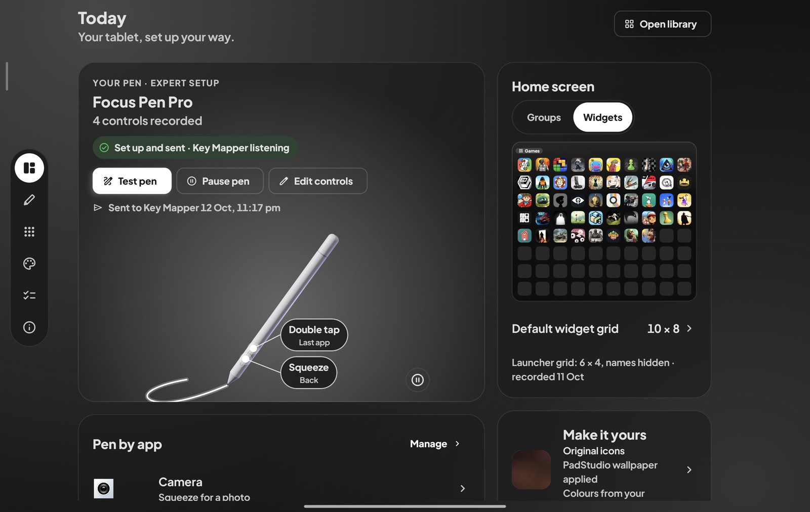
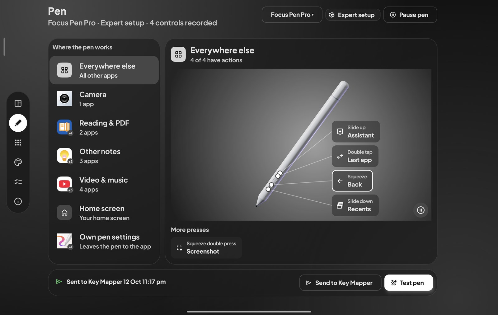
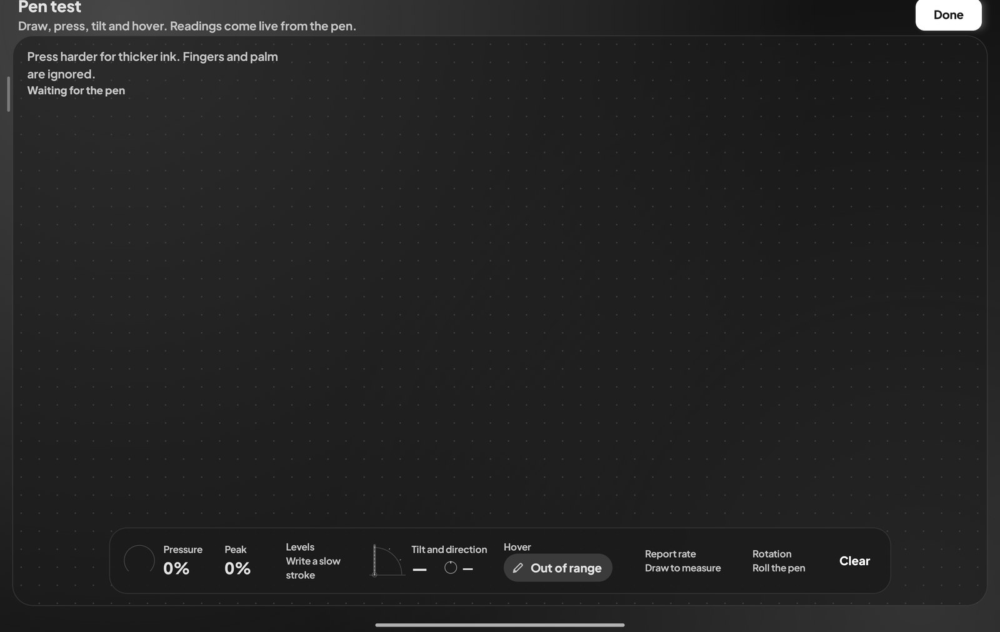
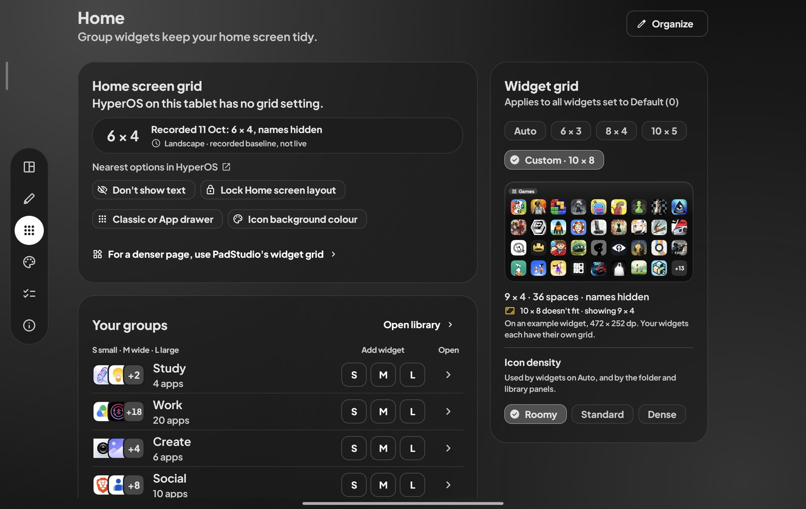
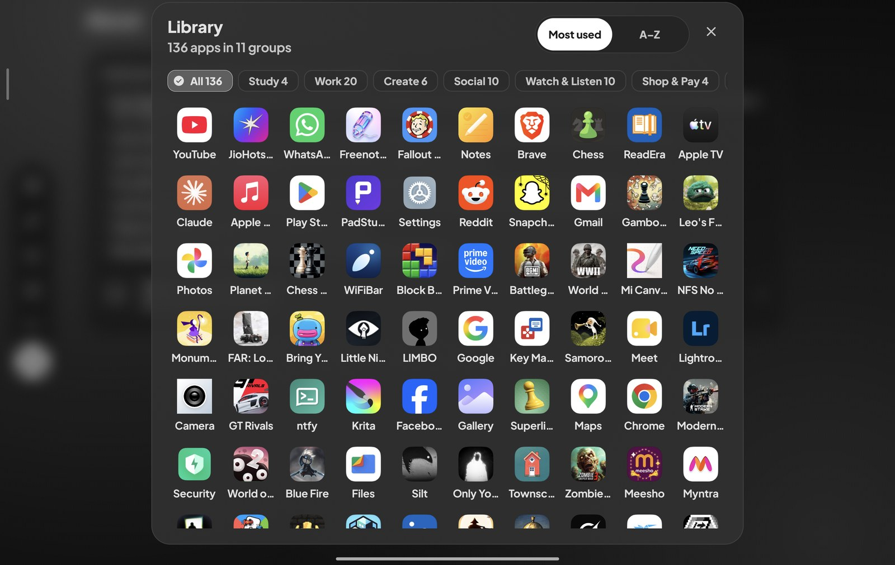
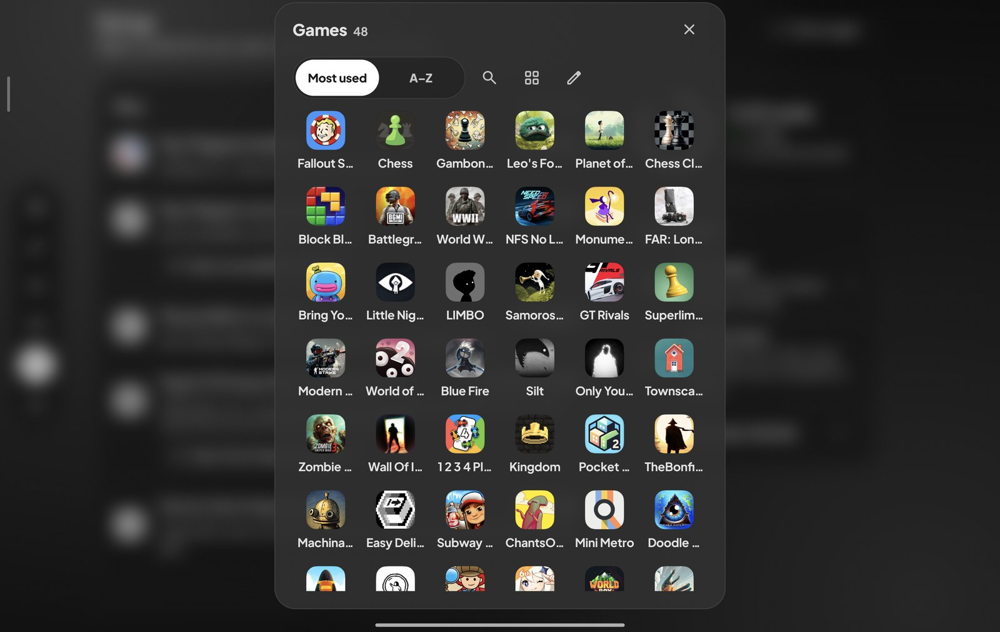
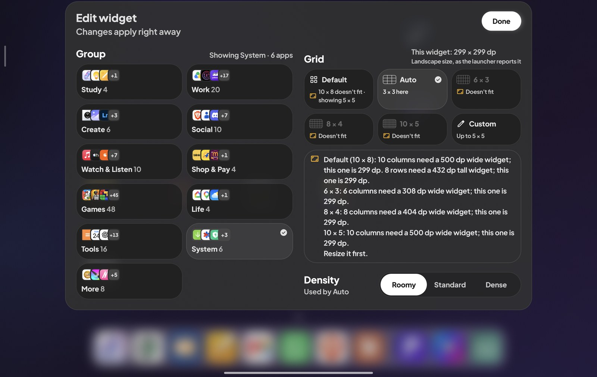
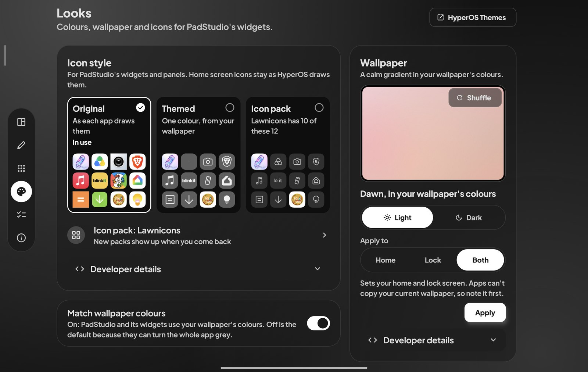
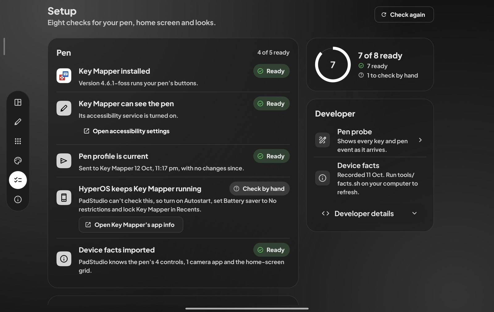
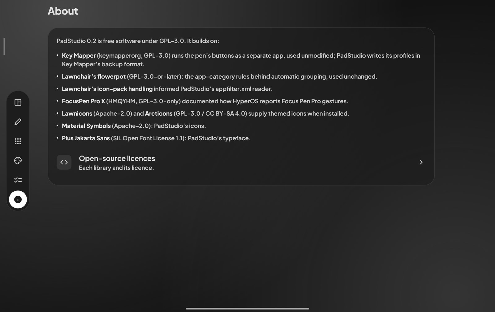

# PadStudio

PadStudio makes a Xiaomi Pad's pen (the Focus Pen Pro, or a two-button pen) useful in every app: you choose what each gesture does, per kind of app, from a camera shutter and page turns to undo and screenshots. It also tidies the home screen into dense, auto-grouped widgets and gives the tablet a coherent look. It needs no root and can be undone. It runs on top of the stock HyperOS launcher, and [Key Mapper](https://github.com/keymapperorg/KeyMapper) runs the pen: PadStudio configures it but does not modify it.

<p align="center">
  <a href="https://github.com/charanteja0017/padstudio/releases/latest/download/PadStudio.apk"></a>
  &nbsp;
  <a href="https://github.com/charanteja0017/padstudio/releases"></a>
</p>



## Download

**[Download the latest PadStudio APK](https://github.com/charanteja0017/padstudio/releases/latest/download/PadStudio.apk)** (now 0.2, 57.6 MB). This link and the button above always fetch the newest release, and the button shows its version.

| Version | Released | Download | Size | Notes |
|---|---|---|---|---|
| **0.2** (latest) | 13 Oct 2026 | [PadStudio-0.2.apk](https://github.com/charanteja0017/padstudio/releases/download/v0.2/PadStudio-0.2.apk) | 57.6 MB | [Release notes](https://github.com/charanteja0017/padstudio/releases/tag/v0.2) |

Every version is on the [releases page](https://github.com/charanteja0017/padstudio/releases).

SHA-256 of 0.2 (`PadStudio-0.2.apk`, and `PadStudio.apk` from the button, which is the same file): `d1c0d32c83d0e876bd4ad6744454596084d11fedd029443c256341acefed14c8`. Check it with `shasum -a 256 <file>` on macOS or Linux, or `certutil -hashfile <file> SHA256` on Windows.

It is the debug-signed build that was tested on the tablet. When Android asks, allow installs from the browser or file manager you opened the file with.

## What you need

| Need | Details |
|---|---|
| Tablet | A Xiaomi Pad on HyperOS. Built and tested only on one Xiaomi Pad 8 (model 25097RP43I, codename `yupei`, India build) running HyperOS 3.0.303 on Android 16. |
| Android | 12 or newer (`minSdk` 31). The APK carries arm64-v8a native libraries only. |
| Pen | Xiaomi Focus Pen Pro (tested), or a two-button pen: Smart Pen 2 or Focus Pen. The repository has no test records from a real two-button pen; that profile is covered by unit tests only. |
| Key Mapper | Version 4.6.1, the `foss` build (`keymapper-4.6.1-foss.apk`, package `io.github.sds100.keymapper`), unmodified. It runs the pen's buttons: PadStudio hands it a generated profile in one tap. Needed for the pen only; Home and Looks work without it. |
| Launcher | The stock HyperOS launcher, kept, so full-screen gestures, the dock and split-screen keep working. On the author's tablet a third-party launcher switched HyperOS to 3-button navigation ([ADR-003](docs/decisions/ADR-003-launcher.md)). |
| Expert setup | Needed for the Focus Pen Pro's gestures; on a two-button pen it only adds holds. It uses Key Mapper's Expert Mode, which needs wireless debugging, and a one-time `device-facts.json` built on a computer with adb, bash and Python 3 (see [Setting it up](#setting-it-up)). `tools/facts.sh` is written for the Focus Pen Pro. Basic setup needs none of this. |
| Root | None, and no bootloader unlock. |

## What it does

PadStudio has six tabs: Today, Pen, Home, Looks, Setup and About.

### Today

The start screen: where the pen, the home screen and the setup stand, in one place.

- The pen card names your pen and says what PadStudio can see, for example "Set up and sent · Key Mapper listening" or "Set up, changes not sent yet". It never claims the pen works, because an app cannot see that.
- Quick actions: Test pen, Pause pen or Resume pen, Edit controls, and Send to Key Mapper when there is something to send.
- Cards for Pen by app, Home screen (a widget preview with your icons, and the default widget grid), Make it yours (icon style, wallpaper, colours) and Health ("N of 8 ready", with a Fix for the first problem).
- Open library, top right, opens the app library.

### Pen



Choose what each gesture does, per kind of app, and hand the result to Key Mapper.

- The header menu picks the pen: Focus Pen Pro (squeeze, slide up, slide down, double tap) or Two-button pen (an upper and a lower button). The chip beside it is the setup, Basic or Expert, and opens Advanced.
- "Where the pen works" lists Everywhere else, Camera, Reading & PDF, Other notes, Video & music, Home screen and Own pen settings (notes apps such as Mi Canvas, which keep the pen's buttons: PadStudio leaves them alone). Apart from Everywhere else, a group appears only when one of its apps is installed.
- Tap a gesture's callout (Focus Pen Pro) or a cell (two-button pen) to open the action picker: 25 actions in five groups (Camera, Reading & notes, Media, Navigation, System), searchable, plus "Nothing (leave to the app / HyperOS)".
- The bottom bar has Send to Key Mapper and Test pen. Pause pen asks Key Mapper to switch the pen's actions off, and Resume pen asks it to switch them on again. A "Needs a look" chip says in plain words when an action will do nothing, for example because a control has not been recorded.
- Advanced holds the setup, "Key Mapper can press keys" (Expert only), the notes app that "Open notes app" starts, Reset pen actions, and Developer details (key codes, Record, Forget).

Defaults for the Focus Pen Pro (every cell can be changed; "squeeze twice" is two squeezes in a row):

| Where the pen is used | Squeeze | Slide up | Slide down | Double tap |
|---|---|---|---|---|
| Camera | Shutter | – | – | Shutter |
| Reading & PDF | – | Previous page | Next page | Last app |
| Video & music | Play/pause | – | – | Next track |
| Home screen | Open app library; squeeze twice: Open camera | – | – | Last app |
| Everywhere else | Back; squeeze twice: Screenshot | – | – | Last app |
| Notes apps | – | – | – | – |

For the Focus Pen Pro, notes apps have no default actions, and pen-native ones such as Mi Canvas are left to handle the pen themselves. A two-button pen starts with Shutter in Camera, page turns in readers, Undo and Redo in other notes apps, Play/pause and Back in media apps, Open app library and Open notes app on the home screen, and Screenshot and Back everywhere else.

<p>
  
</p>

- **Pen test** (from Today or Pen): draw on the canvas and watch pressure (a ring, the stroke's peak and the levels the pen resolves), tilt and direction, hover, report rate and barrel rotation live. Fingers and palm are ignored. On the author's Pad 8 with the Focus Pen Pro, the digitizer reported 16,384 pressure levels, tilt up to ±60° per axis and about 227 to 240 samples a second ([ADR-002](docs/decisions/ADR-002-pen-path.md)).
- **The 3D pen** is a live Focus Pen Pro model that plays a clip for each gesture and zooms to the grip band while it does. The model is a placeholder with a nominal length of 165 mm, and the gesture spots on it are a design choice, not measurements of the real pen ([`Branding/pen3d/README.md`](Branding/pen3d/README.md)). Where OpenGL ES 3 is missing it draws a 2D pen; with Android's "Remove animations" on it holds a still pose.

### Home



- **Groups.** Twelve groups sort your apps: Study, Work, Reading, Create, Social, Watch & Listen, Shop & Pay, Games, Life, Tools, System and More. The first rule that matches wins: your own choice, PadStudio's app list, Lawnchair's flowerpot rules, the app's Android category, its name, then Xiaomi and Android system apps, which go to System. The rest go to More, and so does a group with only one app. Hidden keeps apps out of every widget without uninstalling them.
- **Group widgets** in three sizes (Small 2×2, Wide 4×2, Large 4×4): the group's apps in a grid, a header pill with the group's name and app count that opens its folder panel, an edit button, and a "+N" last cell when not every app fits. They are translucent glass tinted to the wallpaper. A background check about every 15 minutes refreshes them when apps are installed or removed.
- **Widget grid** for widgets set to Default: Auto, 6×3, 8×4, 10×5, or Custom (4 to 10 columns, 2 to 8 rows). A widget can have its own grid, and one too small for its grid shows a smaller one and says so ("8 × 4 doesn't fit · showing 6 × 3"). Icon density is Roomy, Standard or Dense.
- **Organize** moves apps between groups (tap an app, choose a group) and can undo all your moves.
- **Home screen grid.** HyperOS has no grid setting on the tablet ([ADR-005](docs/decisions/ADR-005-home-grid.md)), so this card shows the grid recorded on the author's tablet (6 × 4, names hidden) as a dated baseline, never as a live reading, with links to HyperOS's nearest options: Don't show text, Lock Home screen layout, Classic or App drawer, and Icon background colour. PadStudio's widget grid is the way to a denser page.

<p>
  
  
</p>

<p>
  
</p>

- **Library** (left): every app in your groups, with a chip per group and the order Most used or A–Z. Long-press an app for App info, Move to group, Hide or Uninstall. It opens from Today, from Home, or from the pen's "Open app library" action.
- **Folder panel** (right): one group's apps, opened from a widget's header or its "+N" tile, with Search, Open library and Edit widget. Panels blur what is behind them when HyperOS allows it, and dim it otherwise.
- **Edit widget**: the widget's group, grid and density. Changes apply right away, and the grid picker disables a grid the widget is too small for and says why.

### Looks



- **Icon style** for PadStudio's widgets and panels, previewed on twelve of your apps: Original; Themed (one colour from your wallpaper, using the app's monochrome layer on Android 13 and later, or a Lawnicons glyph); or Icon pack (any installed ADW or Nova icon pack, such as Lawnicons or Arcticons). Home screen icons stay as HyperOS draws them.
- **Match wallpaper colours** is off by default, because wallpaper colours can turn the whole app grey.
- **Wallpaper**: a generated calm gradient, light or dark, with Shuffle for another, applied to Home, Lock or Both. Apps can't copy your current wallpaper, so note it first.
- **HyperOS Themes** opens the system Themes app, the route to home screen icons, when the tablet has one.

### Setup



- Eight checks for the pen, the home screen and the looks, grouped as Pen, Home and Looks. Each is Ready, Needs attention or Check by hand, and some have a button that opens the matching Android screen, such as Open accessibility settings. A ring shows "N of 8 ready", and Check again reads them afresh.
- Check by hand marks what an app cannot read, such as HyperOS's background settings for Key Mapper. It is never counted as ready.
- Developer: the **Pen probe** lists every key and pen event as it arrives and can save them to `files/pen-probe.txt`; **Device facts** shows whether `device-facts.json` was imported and when its home-screen grid was recorded.

### About



- PadStudio's version and licence (GPL-3.0), and the open-source work it builds on, which is listed under [Credits and licences](#credits-and-licences) below.
- Open-source licences lists every bundled library with its licence text.

## Setting it up

Do these once, in this order. Steps 1 to 5 are for the pen; the home screen and looks features (steps 6 and 7) work without Key Mapper.

1. **Install Key Mapper 4.6.1.** Get `keymapper-4.6.1-foss.apk` from [Key Mapper's releases](https://github.com/keymapperorg/KeyMapper/releases) and install it; its SHA-256 is in [ADR-000](docs/decisions/ADR-000-baselines.md). PadStudio's own messages say "Install it from your computer with tools/install.sh keymapper"; that script is only the adb route to the same APK.
2. **Install PadStudio**: [download the APK](https://github.com/charanteja0017/padstudio/releases/latest/download/PadStudio.apk), open it and install, then open PadStudio. It starts on Today.
3. **Open Setup and work through the Pen checks.** "Key Mapper can see the pen" needs Key Mapper's accessibility service turned on; its Fix button opens Android's accessibility settings. If Android says "Restricted setting", open Key Mapper's App info, tap ⋮, choose Allow restricted settings, then try again.
4. **Keep Key Mapper running on HyperOS.** Setup shows "HyperOS keeps Key Mapper running" as Check by hand, because apps cannot read these settings. Its button opens Key Mapper's app info: turn on Autostart, set Battery saver to No restrictions, and lock Key Mapper's card in Recents (pull the card down).
5. **Set up the pen** on the Pen tab.
   - Pick the pen in the header menu: Focus Pen Pro or Two-button pen. PadStudio starts as a two-button pen in Basic setup. Switching pen or setup clears recorded buttons and your own action choices; it asks first when there is something to lose.
   - Pick the setup with the chip in the header:
     - **Basic**: Key Mapper sees the pen through its accessibility service and nothing needs redoing after a reboot, but presses HyperOS keeps for itself (holds, Focus Pen Pro gestures) cannot be changed.
     - **Expert**: Key Mapper's Expert Mode takes the pen's input device, so every press can be mapped. It needs wireless debugging and restarts itself on Wi-Fi. The Focus Pen Pro needs Expert, because HyperOS keeps its gestures from apps.
   - Make sure PadStudio knows the pen's controls. Basic setup: tap one of a control's cells, choose Record, then press that button within 15 seconds (Key Mapper pauses meanwhile). Expert setup: load the device facts, below.
   - Choose actions: tap a gesture or cell and pick from the list. The defaults are a starting point.
   - Camera shutter, Expert setup: turn on "Key Mapper can press keys" (Advanced) after enabling Key Mapper's Expert-mode setting for key event actions. On the author's tablet an injected Volume down takes the photo in Xiaomi Camera, while clicking its shutter button through Key Mapper did nothing ([ADR-002](docs/decisions/ADR-002-pen-path.md)).
   - Press **Send to Key Mapper** on Pen (or Today). PadStudio writes the profile and opens Key Mapper's restore screen; when Key Mapper asks how to restore, choose **Replace**. Back in PadStudio the status line reads "Sent to Key Mapper" with the time.
   - Replace removes every key map already in Key Mapper, so back those up first if you use it for anything else. PadStudio marks the profile as sent when it hands it over; it cannot see whether you finished the restore.
6. **Add group widgets.** On Home, press S, M or L beside a group to ask the launcher to add that widget, or long-press the home screen and open Widgets, PadStudio, App group. A widget with no group shows "Choose a group", and its Choose button opens Edit widget.
7. **Optional.** Install Lawnicons or Arcticons for themed or icon-pack icons, choose a wallpaper in Looks, and allow Usage access (the Library offers Allow) so "Most used" ranks by the time apps were open.

### Expert setup: load the device facts

Expert setup reads the pen's input device, and for the Focus Pen Pro its gestures, from `device-facts.json`. `tools/facts.sh` builds the file on a computer and pushes it into the app. (Setup lists the "Device facts imported" check as optional, which holds for Basic setup.)

HyperOS keeps the Focus Pen Pro's gestures from apps, so PadStudio cannot record them on the tablet (it would say "No key reached PadStudio, so HyperOS keeps that button for itself"). The script is written for that pen: it names the pen's device, and the codes for squeeze, slide up, slide down and double tap are the ones measured on the author's Pad 8 (see `tools/facts.sh` and [ADR-002](docs/decisions/ADR-002-pen-path.md)).

1. Turn on USB debugging as described under [Device tools](#device-tools-for-development), connect the tablet to the computer and accept the prompt.
2. In a clone of this repository, run `tools/probe-device.sh --camera-keys` and then `tools/facts.sh`. The probe is read-only except that it opens Xiaomi Camera and may leave up to two test photos; `--camera-keys` is how PadStudio learns which key takes a photo there. `tools/facts.sh` pushes the file with `adb shell run-as`, which works because the APK is a debug build.
3. In Setup, press Check again. "Device facts imported" turns Ready and the Pen tab shows 4 controls recorded. The first time PadStudio reads the file it takes the pen and setup from it (Focus Pen Pro, Expert) and resets your pen actions to that pen's defaults.

## Permissions and privacy

This is the full list in the built debug APK. The first three are declared in `padstudio/app/src/main/AndroidManifest.xml`; libraries add the rest.

| Permission | Why |
|---|---|
| `QUERY_ALL_PACKAGES` | Sorting every installed app into groups needs the full app list. The manifest notes the app is sideloaded, for personal use. |
| `PACKAGE_USAGE_STATS` | Optional Usage access, which you grant in Settings. "Most used" ranks apps by the time they were open; without it, PadStudio counts launches from its own panels. |
| `SET_WALLPAPER` | Applying a generated wallpaper from Looks. |
| `WAKE_LOCK`, `ACCESS_NETWORK_STATE`, `RECEIVE_BOOT_COMPLETED`, `FOREGROUND_SERVICE` | Added by WorkManager (androidx.work 2.12.0), which runs the periodic check that keeps the group widgets current. |
| `com.charan.padstudio.DYNAMIC_RECEIVER_NOT_EXPORTED_PERMISSION` | Added by AndroidX core. A signature-level permission, so only PadStudio can hold it. |

- PadStudio has no internet permission. The 3D pen library (SceneView) asks for `INTERNET` and `VIBRATE`; the manifest removes both, and the 3D pen loads from the APK. Neither is in the merged manifest or the built APK.
- PadStudio has no accessibility service. The accessibility service and Expert Mode belong to Key Mapper, which runs the pen.
- What PadStudio remembers lives in its private storage: settings in `files/config.json`, the optional `device-facts.json`, and small preferences for the panels (sort order and launch counts). Backup is allowed (`allowBackup`), so Android may include that storage in a device backup. The one file PadStudio hands to another app is the generated pen profile, shared read-only with Key Mapper's restore screen.

## Build from source

You need JDK 17 and the Android SDK with platform 37 (`compileSdk` 37). The Gradle wrapper is at `padstudio/gradlew` and fetches Gradle 9.8.1 on first use. The project uses AGP 9.4.1, Kotlin 2.4.21 and Java 17 (`jvmTarget` 17). `:core` is pure Kotlin on the JVM (pen-profile generation, app categorisation, group planning); `:app` is the Compose and Glance app.

```sh
cd padstudio
./gradlew :app:assembleDebug        # APK in padstudio/app/build/outputs/apk/debug/
./gradlew :core:test :app:testDebugUnitTest
```

Two settings point at the author's Mac. `padstudio/gradle.properties` pins `org.gradle.java.home` to a Homebrew JDK 17 (`/opt/homebrew/opt/openjdk@17/...`): change or remove that line to use your own. `padstudio/local.properties` (git-ignored) holds `sdk.dir`: create it with your own SDK path, or set `ANDROID_HOME`, as `tools/env.sh` does.

To publish a version, attach its APK to the GitHub release twice: as `PadStudio-<version>.apk`, which the versions table links, and as `PadStudio.apk`, the fixed name the Download button asks GitHub for (`releases/latest/download/PadStudio.apk`). Then add the version's row to the table under [Download](#download); the button reads the latest version from GitHub by itself.

## Repository layout

Pad Suite is the working name of the whole project: the app, the scripts that measured the tablet, and the records of what they found. [`docs/PLAN.md`](docs/PLAN.md) is the original plan; the ADRs in `docs/decisions/` record what was measured and decided. Pinned versions and checksums: [`docs/decisions/ADR-000-baselines.md`](docs/decisions/ADR-000-baselines.md).

```
docs/      PLAN.md, device profile, decisions (ADRs), design previews (docs/redesign), test evidence (docs/test-logs), README images (docs/screenshots)
tools/     adb scripts (bash) + parsers with tests (tools/lib, python3 -I)
padstudio/ the app (:core pure Kotlin, :app Compose + Glance)
Branding/  app icon and brand artwork, the 3D pen builder (Blender), logo probes
forks/ reference/ apks/   upstream sources and APKs (not committed; see ADR-000)
```

## Device tools (for development)

Bash and Python 3 scripts that talk to one tablet over adb (USB or wireless debugging). They measured the pen and the launcher and produced the evidence in `docs/`. You need them only for the Expert setup step above. They were written and run on a Mac: `tools/env.sh` defaults the SDK to a Homebrew path, which `ANDROID_HOME` overrides.

```sh
tools/env.sh --check                 # toolchain, disk, connected device
tools/probe-device.sh                # read-only device profile + rollback baseline (run first!)
tools/probe-device.sh --camera-keys  # also finds Xiaomi Camera's shutter and which key takes a photo
tools/capture-pen.sh upper-short     # record what one pen press produces (repeat per button/press)
tools/capture-pen.sh --matrix        # → docs/device/pen-matrix.md
tools/facts.sh                       # build device-facts.json from the probe and push it into PadStudio
tools/install.sh keymapper           # pen engine; then lawnicons, padstudio
tools/pen-health.sh [--fix]          # is Key Mapper's Expert Mode holding the pen? --fix restarts it
tools/watch-pen.sh                   # watch what pen presses do (foreground app, photo and screenshot counts)
tools/shot.sh home-compact           # screenshot evidence → docs/test-logs/
tools/rollback.sh --dry-run          # see what undo would do; drop --dry-run to undo everything
```

Before the first run, on the tablet: Settings → About tablet → tap *OS version* 7×, then in Developer options turn on **USB debugging**, **Install via USB** and **USB debugging (Security settings)**.

`tools/rollback.sh` restores what `docs/device/baseline.env` records, and in this repository that file is the author's own Pad 8 baseline: the probe keeps an existing baseline unless you pass `--rebaseline`. On another tablet, run `tools/probe-device.sh --rebaseline` before you change anything, or do not use rollback. It uninstalls PadStudio, and Key Mapper unless you pass `--keep-keymapper`.

On the tablet itself, undoing PadStudio is plain: uninstall PadStudio (its widgets go with it) and Key Mapper. A wallpaper you applied stays until you set another.

Also in `tools/`: `ui-tour.sh` and `redesign-check.sh` take the screenshots in `docs/test-logs/`, `tap-text.sh` taps on-screen text found with uiautomator, and `spike/padpen-probe` is the ADR-006 spike.

Tests for the scripts' parsers: `python3 -I tools/lib/test_make_profile.py && python3 -I tools/lib/test_pen_matrix.py && python3 -I tools/lib/test_make_facts.py`.

## Credits and licences

PadStudio is free software under [GPL-3.0](LICENSE). It reuses GPL-3.0-or-later data and code from Lawnchair's *flowerpot* categoriser. Key Mapper (GPL-3.0) is used unmodified as a separate app. PadStudio builds on this open-source work:

- **Key Mapper** (keymapperorg, GPL-3.0) runs the pen’s buttons as a separate app, used unmodified; PadStudio writes its profiles in Key Mapper’s backup format.
- **Lawnchair’s flowerpot** (GPL-3.0-or-later): the app-category rules behind automatic grouping, used unchanged.
- **Lawnchair’s icon-pack handling** informed PadStudio’s appfilter.xml reader.
- **FocusPen Pro X** (HMQYHM, GPL-3.0-only) documented how HyperOS reports Focus Pen Pro gestures.
- **Lawnicons** (Apache-2.0) and **Arcticons** (GPL-3.0 / CC BY-SA 4.0) supply themed icons when installed.
- **Material Symbols** (Apache-2.0): PadStudio’s icons.
- **Plus Jakarta Sans** (SIL Open Font License 1.1): PadStudio’s typeface.

This is the list on the app's About screen, which also shows every bundled library and its licence (About → Open-source licences). Upstream sources, versions and checksums are in [ADR-000](docs/decisions/ADR-000-baselines.md).

## Limitations

- **One tablet.** Everything was measured and tested on one Xiaomi Pad 8 (HyperOS 3.0.303, Android 16) with a Focus Pen Pro. Other pads and firmware are untested, and the two-button profile has unit tests but no recorded test on a real pen. Only Key Mapper 4.6.1 was tested; PadStudio writes the profile in that version's backup format, and newer versions are untested.
- **Expert setup needs a computer.** The Focus Pen Pro needs Expert, because HyperOS keeps its gestures from apps. Expert reads the pen's device and gestures from `device-facts.json`, which `tools/facts.sh` builds with adb for the Focus Pen Pro only; a two-button pen stays in Basic unless you adapt the script. Expert Mode needs wireless debugging and restarts itself on Wi-Fi. The camera shutter also needs "Key Mapper can press keys": on the author's tablet, clicking Xiaomi Camera's shutter button through Key Mapper did nothing.
- **Key Mapper has to be kept running.** HyperOS may stop it unless Autostart, Battery saver and the Recents lock are set, and PadStudio cannot check those or whether Expert Mode is running. It reports only whether Key Mapper's accessibility service is on and what it last sent. In Key Mapper 4.6.1, Expert Mode's bridge can stop holding the pen after the pen reconnects (a likely lock-order deadlock, seen twice on the author's tablet). Squeezes then go to HyperOS until `tools/pen-health.sh --fix` restarts the bridge ([ADR-002](docs/decisions/ADR-002-pen-path.md)).
- **HyperOS limits what an app can change.** On the author's tablet it has no home-screen grid setting, so PadStudio's widget grid is the way to a denser page, and the grid shown on Home is a recorded baseline, not a live reading. HyperOS cannot blur what is behind a third-party widget, so the widget glass is translucency. PadStudio does no system-wide theming: icon style and colours apply to its own widgets and panels.
- **"Most used" needs Usage access.** Without it, the Library and folders rank by the launches PadStudio's own panels counted, not by the time apps were open.
- **The app cannot undo a wallpaper.** Apply replaces your wallpaper, and apps can't copy the current one, so note it first.
